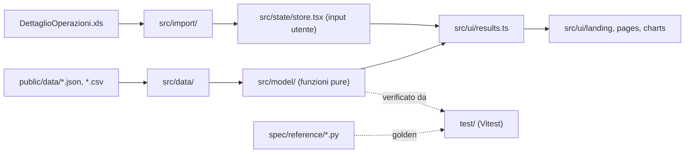

# pac-vs-fp — Fondo Pensione FPDDI contro PAC su ETF

Simulatore indipendente per gli iscritti al Fondo Pensione per i Dipendenti e Dirigenti IBM (FPDDI), comparto Azionario. Confronta **tre scenari con lo stesso identico budget annuo netto**: l'unica scelta è quanto di quel budget versare nel fondo e quanto investire per conto proprio in un PAC su un ETF azionario globale. Funziona interamente nel browser: nessun dato lascia il dispositivo. Non è consulenza finanziaria.

- Sito: https://nine1zero.github.io/pac-vs-fp/
- Licenza: MIT (`LICENSE`). Il codice è pubblico perché chiunque possa controllare dati, fonti e formule.

## I tre scenari

| | Nel fondo (oltre al TFR) | Nel PAC su ETF |
|---|---|---|
| **1 – Minimo per contributo + PAC** (Ibrido · Match + PAC) | contributo minimo dell'aderente, che fa scattare il contributo dell'azienda | il resto del budget + il risparmio fiscale |
| **2 – Deduzione massima (no PAC)** (Solo Fondo) | versamento fino al limite deducibile di 5.300 € (azienda inclusa); con il budget predefinito è tutto il budget | solo il rimborso fiscale (e l'eventuale budget oltre la deduzione massima) |
| **3 – Assenza deduzione e contributo (solo PAC)** (Solo PAC) | solo il TFR, nessun contributo dell'aderente né dell'azienda | tutto il budget |

I nomi mostrati nell'interfaccia sono in `SCENARIO_NAMES` e `SCENARIO_ROLE` (`src/ui/results.ts`).

Il risultato dipende soprattutto dal **differenziale di rendimento δ** (fondo − ETF, prima delle imposte), calibrato sulla storia del comparto ma modificabile dall'utente. Formule complete in `docs/FORMULE.md`.

## Architettura in breve

- **Stack**: Vite + TypeScript + React 18, senza backend. Sito statico su GitHub Pages, navigazione con l'hash dell'URL (`#/`, `#/versamenti`, `#/storico`, `#/parametri`).
- **Dati**: file statici in `public/data/` importati nel bundle (nessuna richiesta di rete dopo il caricamento). Ogni valore ha una fonte citata (`evidence`) e un tooltip nell'interfaccia.
- **Modello**: funzioni pure in `src/model/`, che riproducono al centesimo il modello di riferimento Python in `spec/reference/`. La UI non fa calcoli: passa sempre da `src/ui/results.ts`.
- **Stato**: un unico reducer React (`src/state/store.tsx`) con salvataggio automatico in `localStorage`; "Cancella tutto" svuota ogni dato.
- **Privacy**: CSP restrittiva nel meta tag (`src/csp.ts`), niente CDN, analytics o cookie; il file contribuzioni (`DettaglioOperazioni.xls`) si legge solo in memoria con `DOMParser`.



## Struttura del repository

| Percorso | Contenuto |
|---|---|
| `src/main.tsx`, `src/App.tsx` | Avvio dell'app e router delle pagine |
| `src/model/` | Modello: fisco (`tax.ts`), flussi annui (`flows.ts`), simulazione (`simulate.ts`), forma chiusa (`closedForm.ts`), pareggi (`breakeven.ts`), mappa (`map.ts`), storico (`history.ts`), file contribuzioni (`contributions.ts`), parametri d'esempio (`params.ts`), tipi (`types.ts`) |
| `src/data/` | Caricamento dei dati statici (`index.ts`), catalogo ETF (`catalog.ts`), prezzi mensili (`prices.ts`), elenco fonti e link ai PDF del fondo (`sourcesList.ts`) |
| `src/import/` | Lettura e validazione del `DettaglioOperazioni.xls` (`dettaglio.ts`, `load.ts`) |
| `src/state/` | Stato e salvataggio locale (`store.tsx`), righe della pagina Parametri (`paramRows.ts`) |
| `src/ui/landing/` | Landing: sezioni (`Sections.tsx`, `Sec0`…`Sec6`), menu ETF, contenitore (`Landing.tsx`) |
| `src/ui/pages/` | Pagine "I miei versamenti", "Storico", "Parametri e fonti" |
| `src/ui/charts/` | Grafici SVG senza librerie esterne (barre, linee, serie temporali, mappa) |
| `src/ui/` (file) | Header con fumetto "Migliora il repo" (`Header.tsx`), footer, tooltip delle fonti (`Tip.tsx`), formati it-IT (`format.ts`), controlli, `BackLink.tsx`, `SavingLockNote.tsx`, `results.ts` |
| `src/styles/base.css` | Stili globali |
| `public/data/` | Dati: rendimenti FPDDI (`fpddi_azionario.json`, `fpddi_assicurativo.json`), parametri (`params.json`), catalogo ETF (`etf_catalog.json`), prezzi mensili (`etf_monthly.csv` + fonti), profilo d'esempio inventato (`profile_example.json`) |
| `spec/reference/` | Modello di riferimento Python (`model.py`, `history.py`): fa fede sulle formule |
| `spec/tests/` | Valori di controllo (golden), file `.xls` sintetici, script di generazione e parità |
| `spec/design/` | Prototipi HTML dell'interfaccia (`v2/` in vigore, `v1/` storico) |
| `test/` | Test Vitest: modello, storico, import, UI, CSP, privacy del repository |
| `e2e/` | Test Playwright: privacy di rete, pagine, accessibilità (axe-core, tastiera), Lighthouse |
| `docs/` | `SPEC.md` (specifica), `FORMULE.md` (metodo con esempi), `FONTI.md` (fonte di ogni dato), `VERIFICHE.md` (controlli e punti aperti), `CHANGELOG.md` |
| `CLAUDE.md` | Regole operative per chi sviluppa, incluse le istruzioni per agenti AI |
| `.github/workflows/ci.yml` | CI (typecheck, test, build, Playwright) e deploy su GitHub Pages da `main` |

Nei documenti di `docs/` i percorsi `data/`, `reference/`, `tests/` e `design/` corrispondono a `public/data/`, `spec/reference/`, `spec/tests/` e `spec/design/`.

## Cosa modificare e dove

| Voglio… | File da modificare | Poi |
|---|---|---|
| Aggiornare i rendimenti annui del fondo o del benchmark | `public/data/fpddi_azionario.json` (con `evidence`: documento e pagina) | fonte in `docs/FONTI.md`, voce in `docs/CHANGELOG.md`, `npm test` |
| Aggiornare i prezzi degli ETF | `public/data/etf_monthly.csv`, `etf_monthly.sources.json`, `etf_annual_extra.json` | rigenerare i golden dello storico se cambiano i valori attesi |
| Aggiungere o modificare un ETF del PAC | `public/data/etf_catalog.json` | verificare il menu in `src/ui/landing/EtfMenu.tsx` |
| Cambiare un default, un limite o la descrizione di un parametro | `public/data/params.json` (e `profile_example.json` per i default d'esempio) | fonte in `docs/FONTI.md` |
| Cambiare aliquote, scaglioni, detrazioni, cuneo fiscale | `spec/reference/model.py` → `src/model/tax.ts` | `python3 spec/tests/make_golden.py`, `docs/FORMULE.md` par. 2, `CHANGELOG` |
| Cambiare le regole dei tre scenari o dei contributi | `spec/reference/model.py` → `src/model/flows.ts` | golden, `docs/FORMULE.md` par. 3-5 |
| Cambiare la capitalizzazione o le imposte d'uscita | `spec/reference/model.py` → `src/model/simulate.ts`, `closedForm.ts` | golden, `docs/FORMULE.md` par. 6-7 |
| Cambiare il calcolo del differenziale storico δ | `spec/reference/history.py` → `src/model/history.ts` | `docs/FORMULE.md` par. 8 |
| Cambiare la lettura del file contribuzioni | `src/import/dettaglio.ts`, `src/model/contributions.ts` (riferimento: `history.py`) | fixture in `spec/tests/fixtures/` |
| Cambiare testi, sezioni o layout della Landing | `src/ui/landing/Sections.tsx`, `Landing.tsx`, `src/styles/base.css` | `npm run test:e2e` (accessibilità) |
| Aggiungere un numero mostrato | calcolarlo in `src/ui/results.ts` da `src/model/`, mostrarlo con il tooltip `Tip` | fonte nel tooltip (SPEC par. 3.6) |
| Aggiungere un link a un documento ufficiale | `src/data/sourcesList.ts` | `docs/FONTI.md` |
| Cambiare i formati di numeri e date | `src/ui/format.ts` | `test/ui/format.test.ts` |
| Cambiare la CSP | `src/csp.ts` | `test/csp.test.ts`, `e2e/privacy.spec.ts` |

Regola generale per il modello: **prima** si modifica il riferimento Python, si rigenerano i golden, **poi** si riallinea il TypeScript finché i test passano al centesimo.

## Modello in sintesi

- **Risparmio fiscale esatto** della deduzione `D`: `risparmio(RAL, D) = T(r) − T(r − D)`, dove `T` include IRPEF a scaglioni, detrazione per lavoro dipendente, cuneo fiscale e addizionali (norme 2026).
- **Budget annuo** `K_k` uguale nei tre scenari; nel PAC va `K_k − versamento aderente + risparmio fiscale`.
- **Fondo**: rendimento `r_f = (rendimento lordo ETF − TER ETF di riferimento) + δ`, tassato al 20% ogni anno; all'uscita imposta dal 15% al 9% (pensione) o 23% (riscatto) sulla sola parte dedotta + azienda + TFR.
- **PAC**: rendimento `r_e = rendimento lordo − TER`, bollo 0,2% annuo, plusvalenze al 26% alla vendita.
- **Versamenti a metà anno** (fattore `(1 + r)^0,5`), retribuzione e contributi +2% l'anno, risultati anche in euro di oggi.
- **Pareggi**: il valore di δ per cui due scenari si equivalgono, calcolato con la bisezione sulla forma chiusa.

Dettagli, esempi numerici e ipotesi dichiarate: `docs/FORMULE.md`. Fonti: `docs/FONTI.md`.

## Sviluppo

Serve Node.js 22 (e Python 3 solo per rigenerare i golden).

```
npm ci              # dipendenze (versioni esatte da package-lock.json)
npm run dev         # sviluppo su http://localhost:5173/pac-vs-fp/ (senza CSP: Vite usa script inline)
npm test            # Vitest: modello e storico contro i golden, import dei fixture, fonti dei dati, CSP, privacy del repository
npm run build       # typecheck e build in dist/, con la CSP nel meta tag
npm run preview     # serve la build su http://localhost:4173/pac-vs-fp/
npm run test:e2e    # Playwright sulla build: privacy, pagine, accessibilità, Lighthouse ≥ 95
```

Verifiche sul modello di riferimento:

```
python3 spec/reference/model.py                                           # valori del profilo d'esempio
python3 spec/tests/make_golden.py                                         # rigenera i golden (solo per modifiche volute del modello)
python3 spec/tests/make_golden_parity.py                                  # rigenera i casi di parità con il prototipo (idem)
python3 spec/reference/history.py spec/tests/fixtures/sample_dettaglio_ok.xls
node spec/tests/parity_prototype.js spec/design/v2/Landing.dc.html
```

Deploy: `.github/workflows/ci.yml` esegue typecheck, test, build e Playwright su ogni pull request; a ogni push su `main` pubblica `dist/` su GitHub Pages (Settings → Pages → Source: "GitHub Actions").

## Privacy e dati personali

Nessun dato personale va nel repository: `.gitignore` esclude file `.xls`/`.xlsx` (tranne i fixture sintetici), PDF, `profilo*.json` e cartelle private, e `test/repo-privacy.test.ts` lo verifica a ogni esecuzione dei test. I default pubblici vengono da un profilo d'esempio inventato.

Punti aperti (dati da ricontrollare o aggiornare): `docs/VERIFICHE.md`.
